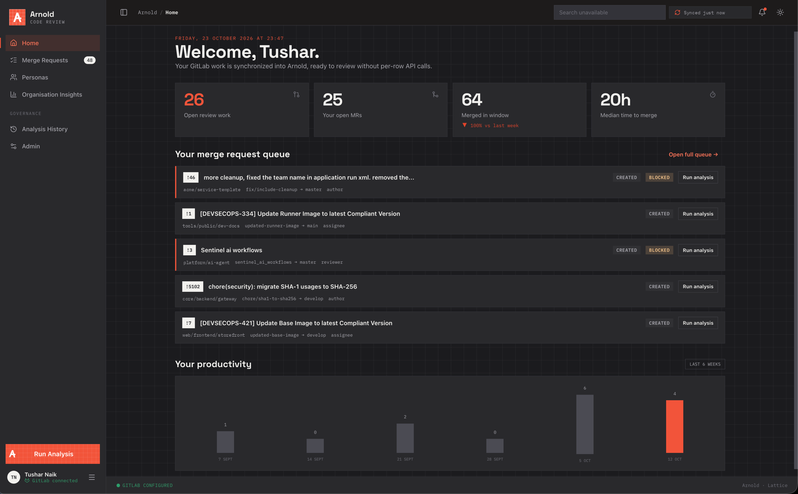
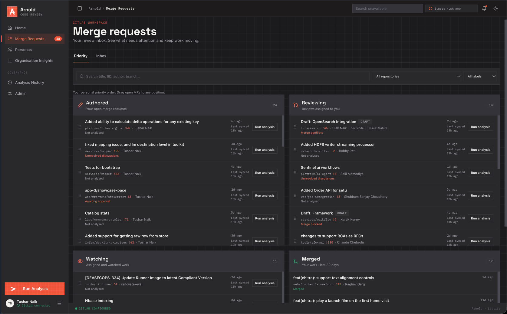

# Home and merge queue

## Home

{ .screenshot }

Home answers "what needs me right now?":

| Card | Meaning |
|---|---|
| Open review work | Open MRs where you are a reviewer or assignee |
| Your open MRs | Open MRs you authored |
| Merged in window | Your merges in the period, with the change versus the previous week |
| Median time to merge | For your merged MRs |

Below the cards, **Your merge request queue** lists the top of your queue with state badges (*Blocked*, *Draft*, …)
and a **Run analysis** shortcut on each row. **Your productivity** charts your merges over the last six weeks.

The merged/median cards and the chart need [Elasticsearch](../setup/storage.md#elasticsearch-optional).

## Merge Requests

{ .screenshot }

**Merge Requests** has two scopes.

### Mine

Change requests you author, review, are assigned to, or watch. Two views:

**Inbox** groups them into sections:

| Section | Contains |
|---|---|
| Needs your review | You are a reviewer |
| Ready to merge | Not a draft, nothing blocking, and the forge reports it mergeable |
| Blocked | Merge conflicts, unresolved blocking discussions, or the forge blocks the merge |
| Drafts | Draft MRs |
| Waiting for review | Yours, not a draft, awaiting approval |
| Watching | Assigned to you or watched |
| Review groups | Your [review groups](review-groups.md) |
| Recently merged | Merged in the last 30 days |

A change request can appear in several sections. Each row shows its review state (*Not analysed*, *Arnold
analysing…*, *Review ready*, …) and blockers (*Merge conflicts*, *Unresolved discussions*, *Awaiting approval*).

**Priority** is your own ordering. Drag rows to reorder; the order is saved per user and used by **Sort → Priority
order** everywhere.

Tools: search by title, `!id`, author or branch; filter by repository and label; sort by recently updated, oldest
updated or priority. To reorder, select **All open** in the inbox and clear filters.

### All open

Every open PR and MR imported by [repository sync](../setup/webhooks-and-sync.md#repository-sync), whether or not
you are involved. Filter by provider (GitLab/GitHub) and state (open/merged/closed). Use it to find work to pick up,
or when your own account is not connected yet.

## How the queue stays fresh

Your queue is built from Arnold's synced copy, not live forge calls, so it loads instantly. It is refreshed by
per-user sync (every 15 minutes, or **Sync now** in notifications), repository sync, and webhooks. See
[Webhooks and sync](../setup/webhooks-and-sync.md).

## Notifications

The bell lists events on your change requests: review requested, assigned, merge blocked, ready to merge, merged,
closed, reopened, and analysis finished. **Mark all read** clears them.
