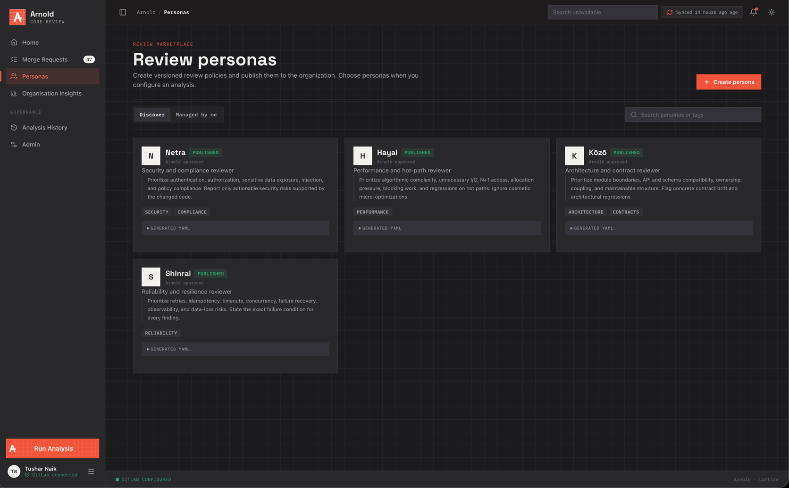

# Review personas

A **review persona** is a reusable review policy: what a specialist reviewer should prioritise, the rules it must
check, and what it should ignore. When you select personas in [Run analysis](run-analysis.md), each one runs as a
separate specialist sub-agent next to the general review, and its findings are labelled with the persona.

{ .screenshot }

## Built-in personas

Arnold ships four *Arnold approved* personas. They cannot be edited.

| Persona | Focus | Guidance |
|---|---|---|
| **Netra** | Security and compliance | Authentication, authorization, sensitive data exposure, injection, policy compliance. Only actionable risks supported by the changed code |
| **Hayai** | Performance and hot paths | Algorithmic complexity, unnecessary I/O, N+1 access, allocation pressure, blocking work, hot-path regressions. Ignores cosmetic micro-optimisations |
| **Kōzō** | Architecture and contracts | Module boundaries, API and schema compatibility, ownership, coupling, structure. Concrete contract drift and architectural regressions |
| **Shinrai** | Reliability and resilience | Retries, idempotency, timeouts, concurrency, failure recovery, observability, data loss. States the exact failure condition for every finding |

## Creating a persona

**Personas → Create persona**:

| Field | Limits | Notes |
|---|---|---|
| Name | 80 chars | Shown on findings: *🎭 **Name** review persona* |
| Summary | 240 chars | One line describing the reviewer |
| Focus tags | up to 5 | For search and grouping |
| Contributors | registered Arnold users | Who can edit, publish and delete it |
| Guidance | 2000 chars | Free-text priorities |
| Rules | up to 20 | `id` + requirement: something every change must satisfy |
| Prerequisites | up to 20 | `id` + *applies when* + requirement: conditional rules |
| Ignore | up to 20 | Things the persona must not report |

At least one of guidance, rules, prerequisites or ignore is required. Rule and prerequisite ids are unique within a
persona (`[A-Za-z0-9][A-Za-z0-9._-]*`). The editor shows the **Generated YAML** that the runner receives:

```yaml
version: 1

guidance: |-
  Review changes to payment flows for correctness under retries and partial failure.

rules:
  - id: idempotency-key
    requirement: |-
      Every new money-moving endpoint accepts and enforces an idempotency key.

prerequisites:
  - id: schema-migration
    applies_when: |-
      The change adds or alters a database migration.
    requirement: |-
      The migration is backwards compatible with the previous release.

ignore:
  - |-
    Logging format and log levels.
```

The generated policy is limited to 8000 characters.

## Lifecycle and versions

- A new persona is a **draft**, visible only to its contributors.
- **Publish** makes it available to everyone in Run Analysis; **Unpublish** withdraws it. Only unpublished drafts
  can be deleted.
- Every save increments the persona's **version**. Edits use optimistic concurrency, so two people cannot overwrite
  each other's changes silently.
- When a run starts, Arnold snapshots the selected personas at their current versions (`netra@3`). Later edits do not
  change a running or completed run, and retries reuse the original versions.

**Discover** lists published personas; **Managed by me** lists those you contribute to, including drafts.

## How persona findings look

On the forge, a persona's comment begins with a visible line such as *🎭 **Netra** review persona*, plus a hidden
marker that ties it to the run and persona version. In Arnold, the finding shows *Raised by the Netra review persona
(v3)*, and the **Persona** tab of the review workspace groups findings by persona.

When a persona and the general review find the same issue, the duplicate is dropped and the persona keeps the
attribution.

## Metrics

With Elasticsearch enabled, each persona card shows runs, findings, posted, accepted, resolved and failed counts, plus
weekly findings and acceptance. Use them to see which personas produce findings authors act on.
