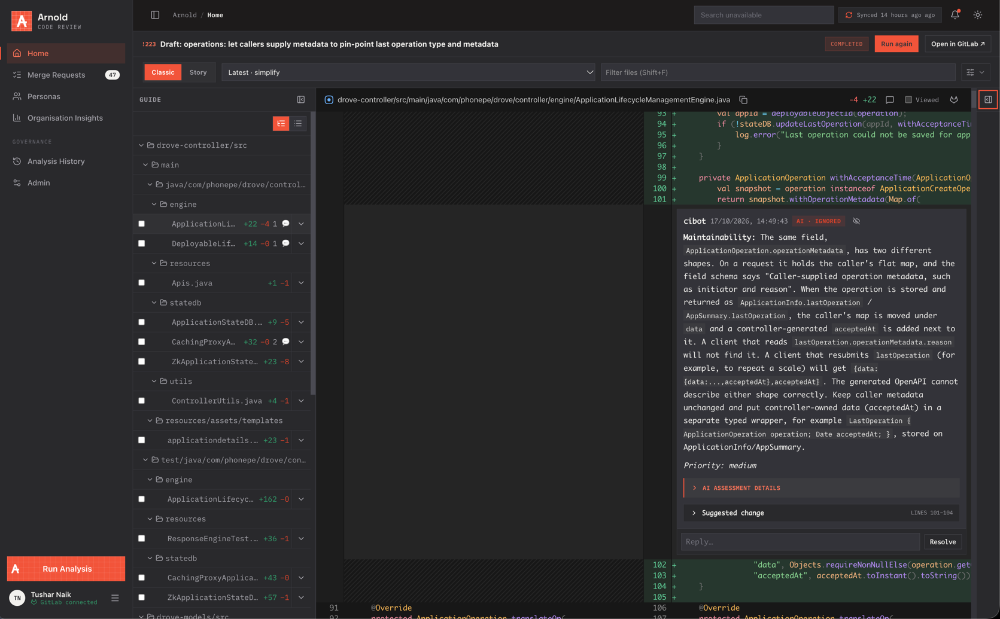

# Review workspace

The review workspace is where you read and review a change request. Open it from any queue row, from
**Analysis History**, or at `/review/<GITLAB|GITHUB>/<repositoryId>/<number>`.

{ .screenshot }

## Layout

| Area | Contents |
|---|---|
| Header | Title, `!number`, repository, source → target branch, state, analysis status, **Run again**, link to the forge |
| Organisation tabs | **Classic** (file tree), **Story** ([story mode](story-mode.md)), **Persona** (findings grouped by persona) |
| Toolbar | Diff version (latest or any earlier push), file filter (++shift+f++), diff preferences |
| Guide (left) | File tree with *Viewed* checkboxes and comment counts, or story steps |
| Diff (centre) | Side-by-side or inline diff with threads |
| Insights (right) | **verdict**, **build**, **details**, **activity** tabs |

Both side panes can be resized or collapsed.

### Diff preferences

- Show one file at a time
- Wrap lines
- Unresolved comments only
- Files with discussions only
- Hide all comments
- Side-by-side / inline

### Insights

| Tab | Shows |
|---|---|
| verdict | Merge state, health (*n/4 merge checks passing*), mergeability, approvals, discussions, conflicts |
| build | Pipeline / checks status and link; analysis run progress (*x/y personas complete*) |
| details | Description, branches, labels, author, assignees, reviewers and their status, last sync |
| activity | Comments and history, filterable and sortable, with a comment composer |

## Commenting and reviewing

- Click a line number to comment on a line; use the file header to comment on the whole file.
- **Comment now** posts immediately. **Add to review** saves a draft; drafts can be edited or discarded.
- **Insert suggestion** adds a suggested-change block.
- Reply to, **Resolve** and **Unresolve** threads. Outdated threads are collected in a collapsible section.
- The review bar publishes all drafts at once, with an optional summary, as **Comment**, **Approve** or
  **Request changes**.
- Add or remove reviewers from the details tab.

Everything is performed on the forge as you, through your connected account.

## AI findings

Findings posted by an analysis run appear as normal threads, with extra context:

- **Persona badge**: *Raised by the Netra review persona (v3)* when a [persona](personas.md) produced it.
- **Priority**: low / medium / high.
- **Suggested change**: the exact lines to replace, shown as a before/after diff. On GitLab, **Apply suggestion**
  commits it to the source branch. (On GitHub, use GitHub's *Commit suggestion*.)
- **AI assessment**: after the author pushes changes, Arnold assesses each finding:

| Badge | Meaning |
|---|---|
| AI · Applied | The change addresses the finding |
| AI · Partially applied | Partly addressed |
| AI · Ignored | Not addressed |
| AI · Not applicable | The finding no longer applies (code removed, false positive) |
| Stale | The assessment was made on an older commit than the current head |

Expand **AI assessment details** to see the reasoning and the assessed commit. These outcomes feed
[review metrics](admin.md#review-metrics) and persona acceptance rates.

## Viewed files

Ticking **Viewed** on a file (or completing a story step) is saved per user and per head commit, so your progress
survives reloads and resets when new commits arrive.
