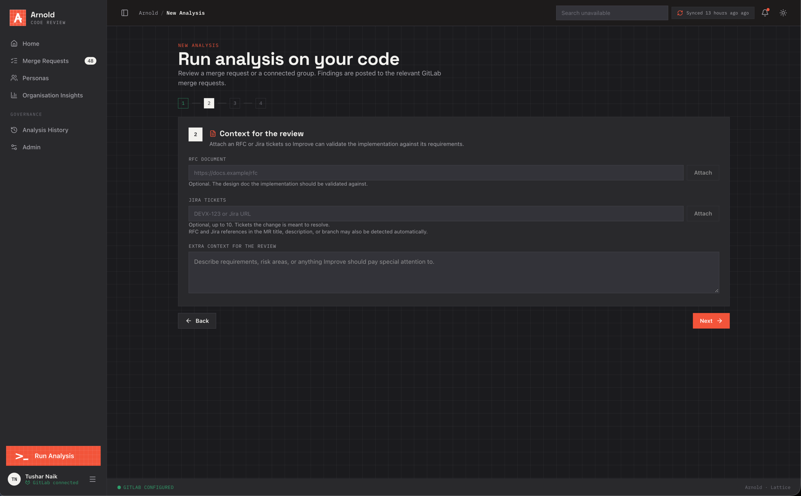
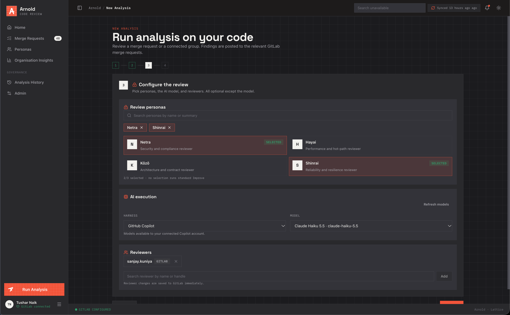

# Run analysis

**Run Analysis** starts an AI review. For a single change it runs the *Improve* workflow: a general review pass plus
up to three [review personas](personas.md), with findings posted as inline comments on the PR/MR.

Open it from the **Run Analysis** button, or from **Run analysis** on any queue row (which pre-fills the change).

## 1. What are you analysing?

- **Single change**: paste a GitLab MR or GitHub PR URL and click **Fetch details**. Any URL works, as long as your
  connected account (and the runner's credential) can read it; the change does not need to be in your queue.
- **Change group**: pick one of your [review groups](review-groups.md) to review several related changes together.

If the change was analysed before, earlier runs are listed with **Open**, **Reuse settings** (prefill the previous
context, personas and model) or **Start fresh**.

## 2. Context for the review

{ .screenshot }

Context makes the review check the change against what it is *supposed* to do:

| Field | Limit | Use |
|---|---|---|
| RFC document | 1 URL | The design doc the implementation should follow |
| Jira tickets | up to 10 | Keys (`PROJ-123`) or URLs of tickets the change resolves |
| Extra context | 4000 chars | Requirements, risk areas, things to focus on or ignore |

RFC and Jira references in the title, description or branch name are also detected automatically. Fetching RFC
content needs `RFC_CENTRAL_API_URL` on the runner; Jira needs the Jira options in the runner
([Runner CLI](../development/runner-cli.md)).

## 3. Configure the review

{ .screenshot }

**Review personas.** Pick up to three. Each runs as a specialist reviewer next to the general pass, and its
findings carry its badge. With none selected, standard Improve runs.

**AI execution.** Choose the harness (OpenCode or GitHub Copilot) and a model. Only available harnesses are offered:
OpenCode when enabled by the administrator, Copilot when enabled and connected in your
[Settings](settings.md). **Refresh models** reloads the list. Leave the model blank to use the deployment default.

**Reviewers.** Add or remove reviewers on the change. These are saved to the forge immediately.

## 4. Review and start

A summary of scope, workflow, harness, model, Jira tickets, notes, personas and reviewers. **Start** creates the run
and dispatches a runner job.

## What happens next

1. The run appears in [Analysis History](analysis-history.md) as *Running*, and the change shows *Arnold
   analysing…*.
2. The runner checks out the change at the head commit, reviews it with the general pass and each persona,
   deduplicates findings, and filters out issues already raised in existing discussions.
3. Findings are posted as inline comments, then reported back to Arnold with their exact comment ids and locations.
4. The run completes (or *Partial* if some personas failed). You get an **Analysis finished** notification. Runs
   time out after 165 minutes.


## API

```http
POST /analyses/v1
{
  "mergeRequestId": "...",
  "rfcUrl": "https://docs.example.com/rfc/42",
  "jiraTickets": ["PROJ-123"],
  "reviewContext": "Focus on backwards compatibility of the public API.",
  "reviewPersonaIds": ["netra", "hayai"],
  "execution": { "harness": "opencode", "model": "openai/gpt-4.1" }
}
```

`GET /analysis-execution/v1` lists available harnesses and models for the current user.
