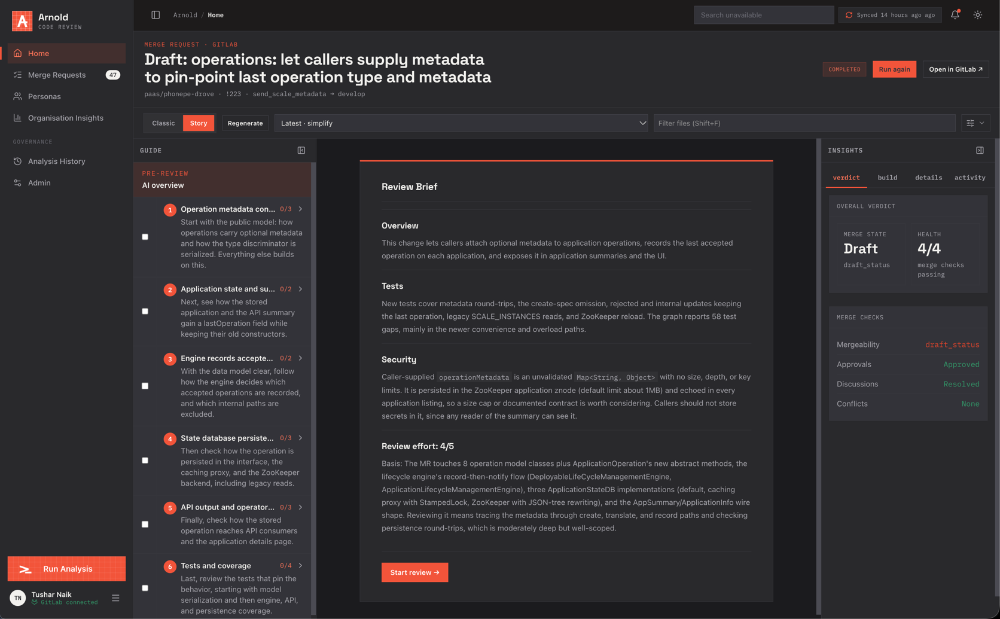
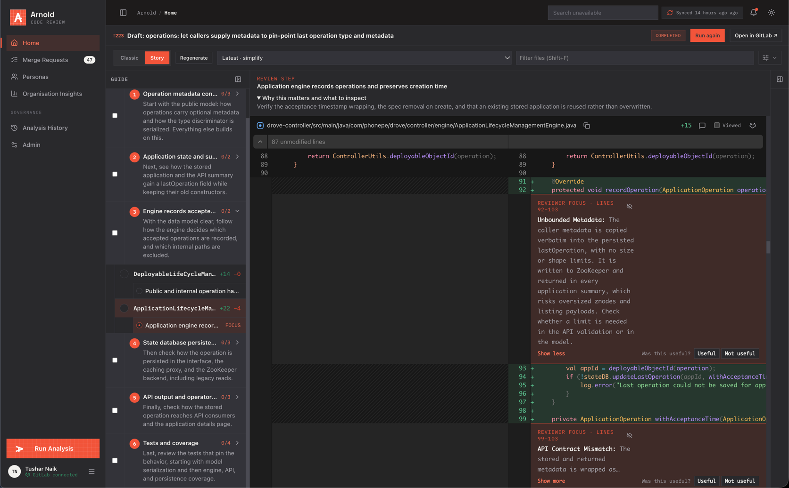

# Story mode

Story mode turns a diff into a guided review. Instead of reading files alphabetically, you get a **review brief** and
an ordered set of **review steps** that tell the story of the change, with **reviewer focus areas** pinned to the
lines that deserve attention.

{ .screenshot }

## Generate a story

1. Open a change request and switch the organisation tab to **Story**.
2. Pick a harness and model (the same choices as [Run analysis](run-analysis.md)).
3. Click **Generate story**. A runner job (`smart_diff` workflow) analyses the change; a link to the job's pipeline
   is shown while it runs.

The story is tied to the head commit. After new pushes, **Regenerate** builds a fresh one. If generation fails or
times out, the classic diff is still available.

## Review brief

The **pre-review** brief summarises the change before you read code:

- **Overview**: what the change does;
- **Tests**: what is covered and the notable gaps;
- **Security**: risks worth checking;
- **Review effort**: a 1–5 estimate with its basis.

**Start review →** moves to the first step.

## Review steps

Each step groups related hunks across files ("Operation metadata contract", "State database persistence", "Tests and
coverage"…), in an order that builds understanding: contracts and models first, then behaviour, then persistence,
APIs and tests. A step has:

- a title and a short description;
- **Why this matters and what to inspect**;
- the hunks to read, with a counter of hunks reviewed (`0/3`);
- a checkbox to mark the step complete (saved per user).

## Reviewer focus areas

{ .screenshot }

Focus areas are inline callouts on specific line ranges: *Reviewer focus · lines 92–103*, with a title such as
*Unbounded metadata* and an explanation of what to verify. They point a human reviewer at the risky parts; they are
not posted to the forge.

Rate each one **Useful** or **Not useful**. Feedback is stored with your review progress and helps tune the
workflow. Hide focus areas with the eye icon.
