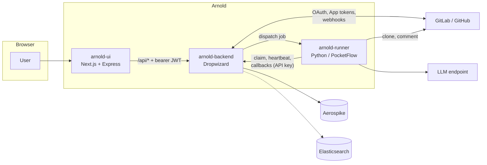
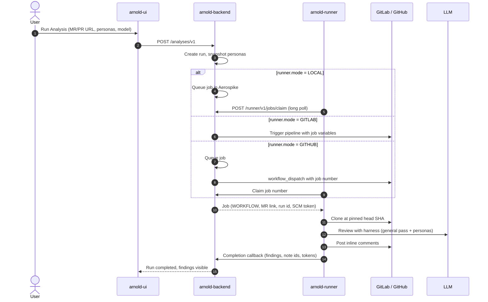

# Architecture

## Components

### arnold-ui

A Next.js application served by a small Express server (`arnold-ui/server.js`). The Express layer:

- signs users in with GitHub, Google or any OpenID Connect provider, or skips sign-in in development mode;
- issues a session cookie holding an HS256 JWT (issuer `arnold-ui`, audience `arnold`);
- proxies `/api/*` to the backend with that JWT as a bearer token.

The UI has no database. See [UI configuration](../configuration/ui.md).

### arnold-backend

A Dropwizard service in three Maven modules:

| Module | Contents |
|---|---|
| `arnold-server` | Application entry point and configuration files |
| `arnold-core` | REST resources, services, GitLab/GitHub providers, auth, runner dispatch, storage |
| `arnold-models` | Request, response and document models shared with clients |

The backend:

- stores users, connections, merge requests, comments, queues, personas and analysis runs in **Aerospike**;
- talks to GitLab with per-user OAuth tokens and to GitHub with GitHub App user-to-server tokens, so actions in
  Arnold are performed as the signed-in user;
- imports open PRs/MRs by periodic repository sync and, when configured, webhooks;
- dispatches review jobs to runners and receives their results;
- writes analytics documents to **Elasticsearch** when it is available.

It listens on port 8090 (API) and 8091 (admin: health checks, metrics, tasks). See
[Backend configuration](../configuration/backend.md).

### arnold-runner

A Python program that runs review workflows on top of [PocketFlow](https://github.com/The-Pocket/PocketFlow). For each
job it checks out the change, runs an agent *harness* (OpenCode or GitHub Copilot) against the code, posts findings
to the forge, and reports results to the backend. The runner holds no state; it needs outbound access to the
backend, the forge and the LLM endpoint only.

Runners can be long-running workers next to the backend, or jobs in GitLab CI or GitHub Actions. See
[Runners](../setup/runners.md).

## Life of an analysis run

GitHub jobs carry a short-lived installation token scoped to the PR's repository (`SCM_GITHUB_TOKEN`), so runners
need no long-lived GitHub credential. GitLab jobs use the runner's `GITLAB_ACCESS_TOKEN`.

## Data stores

| Store | Required | Holds |
|---|---|---|
| Aerospike | Yes | All operational state: users, forge credentials, change requests, comments, queues, personas, runs, runner jobs, notifications |
| Elasticsearch 7.x | No | Analytics: review documents, merge requests, comments, analysis runs, review engagement. Needed for Organisation Insights, home productivity charts, persona metrics and admin review metrics |

See [Storage and analytics](../setup/storage.md).

## Ports

| Port | Component | Purpose |
|---|---|---|
| 3000 | arnold-ui | Web UI and `/api` proxy |
| 8090 | arnold-backend | REST API (also reached by runners and webhooks) |
| 8091 | arnold-backend | Admin: `/healthcheck`, `/metrics`, `/ping` |
| 3000 | Aerospike | Client port (internal to the compose network) |
| 9200 | Elasticsearch | HTTP (internal to the compose network) |
