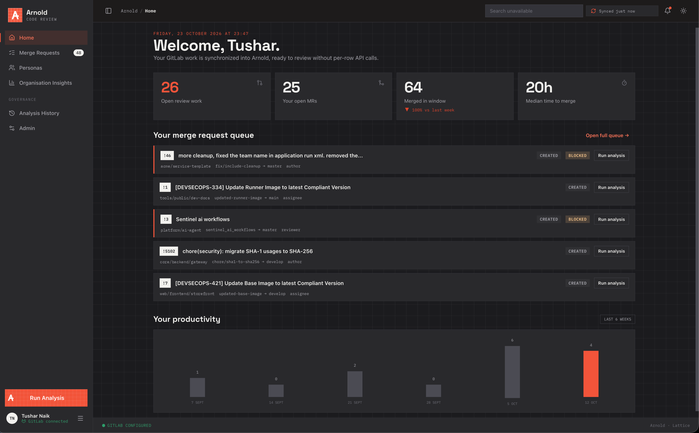
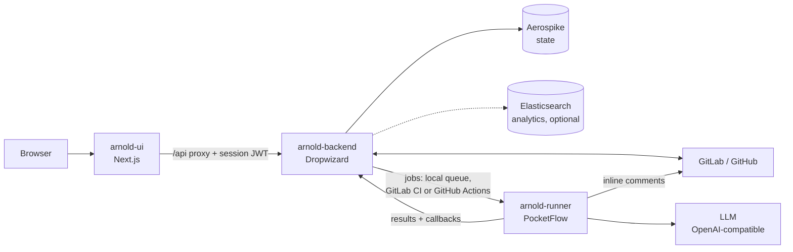

AI code review · GitLab · GitHub

# PhonePe Arnold

Arnold is a self-hosted code review workspace for GitLab merge requests and GitHub pull requests. It gives
reviewers a prioritised merge queue, a full review workspace, and AI review workflows that post inline findings
back to the forge, using any OpenAI-compatible model you bring.

[Quick start](getting-started/quick-start.md){ .md-button .md-button--primary }
[Setup guide](setup/index.md){ .md-button }
[GitHub](https://github.com/PhonePe/arnold){ .md-button }

{ .screenshot }

## What you get

-   :material-format-list-checks: **Merge queue**

    ---

    Every open MR/PR you author, review or watch, in one prioritised inbox. Drag to set your own order.

    [:octicons-arrow-right-24: Home and merge queue](features/merge-queue.md)

-   :material-file-compare: **Review workspace**

    ---

    Diffs, threads, drafts, suggestions, approvals and merge checks without leaving Arnold.

    [:octicons-arrow-right-24: Review workspace](features/review-workspace.md)

-   :material-book-open-page-variant: **Story mode**

    ---

    An AI review brief and guided review steps that walk you through a change in a sensible order.

    [:octicons-arrow-right-24: Story mode](features/story-mode.md)

-   :material-robot-outline: **AI analysis**

    ---

    Run *Improve* on a change or a group of changes, with RFC/Jira context, and get inline findings.

    [:octicons-arrow-right-24: Run analysis](features/run-analysis.md)

-   :material-account-group: **Review personas**

    ---

    Versioned, publishable review policies (security, performance, architecture…) that run as specialist reviewers.

    [:octicons-arrow-right-24: Review personas](features/personas.md)

-   :material-chart-box-outline: **Feedback and insights**

    ---

    Arnold tracks whether authors applied each AI finding, and reports acceptance, token usage and outcomes.

    [:octicons-arrow-right-24: Admin and insights](features/admin.md)

## How it fits together

Read [Architecture](getting-started/architecture.md) for the details.

## Where to start

| You want to… | Read |
|---|---|
| Try Arnold on your laptop in 5 minutes | [Quick start](getting-started/quick-start.md) |
| Connect GitHub or GitLab | [GitHub App](setup/github-app.md) · [GitLab](setup/gitlab.md) |
| Pick the model that writes reviews | [LLM and harnesses](setup/llm.md) |
| Run reviews in CI instead of a local worker | [Runners](setup/runners.md) |
| Put Arnold in front of a team | [Production deployment](setup/production.md) |
| Look up a setting | [Configuration reference](configuration/index.md) |

Arnold is open source under the [Apache License 2.0](https://github.com/PhonePe/arnold/blob/main/LICENSE).
