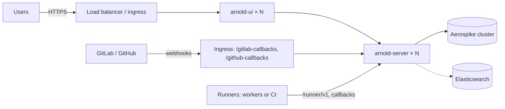

# Production deployment

The quick start is for a single machine with development sign-in. This page covers what changes for a shared
deployment.

## Images

Tagged releases publish images to GitHub Container Registry:

| Image | Port(s) | Config |
|---|---|---|
| `ghcr.io/phonepe/arnold-server:<version>` | 8090 API, 8091 admin | `/app/config/arnold.yml` (defaults to `local.yml`), plus env vars |
| `ghcr.io/phonepe/arnold-ui:<version>` | 3000 | `/app/config/production.yaml` (required), plus env vars |
| `ghcr.io/phonepe/arnold-runner:<version>` | none | Env vars only |

Pin a version tag rather than `latest`. Each image is signed with Sigstore keyless signing and carries an SBOM
and SLSA provenance. Verify an image before deploying it:

```bash
cosign verify ghcr.io/phonepe/arnold-runner:<version> \
  --certificate-identity-regexp '^https://github.com/PhonePe/arnold/.github/workflows/release.yml@refs/tags/v' \
  --certificate-oidc-issuer https://token.actions.githubusercontent.com
```

## Run the published images

This runs each component as its own container on a shared network, with real sign-in. It needs only Docker or
Podman; no build. Replace `v0.1.0` with the release you are deploying.

### 1. Prepare configuration

Generate the shared secrets once and keep them in your secret manager:

```bash
JWT_SECRET=$(openssl rand -hex 32)          # shared by UI sessions and the backend
RUNNER_KEY=$(openssl rand -hex 24)          # runner -> backend
ENCRYPTION_KEY=$(openssl rand -base64 32)   # forge tokens at rest; back it up
```

`arnold.env` (backend):

```bash
ARNOLD_DEV_AUTH=false
ARNOLD_UI_URL=https://arnold.example.com
ARNOLD_UI_JWT_SECRET=<JWT_SECRET>
ARNOLD_RUNNER_API_KEY=<RUNNER_KEY>
ARNOLD_CREDENTIAL_ENCRYPTION_KEY=<ENCRYPTION_KEY>
ARNOLD_RUNNER_MODE=LOCAL
ARNOLD_ADMINS=alice@example.com            # comma separated
AEROSPIKE_HOSTS=arnold-aerospike            # must match the Aerospike container or host name
# ELASTIC_ENABLED=true and ELASTIC_HOST=... to enable analytics
# plus GitHub App / GitLab settings, see deploy/.env.example
```

`runner.env`:

```bash
ARNOLD_URL=http://arnold-server:8090
ARNOLD_RUNNER_API_KEY=<RUNNER_KEY>
CLIO_HARNESS=opencode
# plus LLM settings, see LLM and harnesses
```

`production.yaml` (UI), starting from
[`production.example.yaml`](https://github.com/PhonePe/arnold/blob/main/arnold-ui/config/production.example.yaml):

```yaml
application:
  devMode: false
server: { host: 0.0.0.0, port: 3000 }
api:
  host: http://arnold-server:8090
  domain: arnold-server
  port: 8090
auth:
  mode: oauth
  publicUrl: https://arnold.example.com
  sessionSecret: <JWT_SECRET>
  providers:
    - { id: github, type: github, label: GitHub, clientId: <id>, clientSecret: <secret> }
```

### 2. Start the containers

```bash
docker network create arnold

docker run -d --name arnold-aerospike --network arnold \
  -v $PWD/aerospike.conf:/opt/aerospike/etc/aerospike.conf:ro -v arnold-aerospike:/opt/aerospike/data \
  aerospike/aerospike-server:7.2.0.1 --config-file /opt/aerospike/etc/aerospike.conf

docker run -d --name arnold-server --network arnold --env-file arnold.env -p 8090:8090 \
  ghcr.io/phonepe/arnold-server:v0.1.0

docker run -d --name arnold-ui --network arnold \
  -v $PWD/production.yaml:/app/config/production.yaml:ro -p 3000:3000 \
  ghcr.io/phonepe/arnold-ui:v0.1.0

docker run -d --name arnold-runner --network arnold --env-file runner.env \
  ghcr.io/phonepe/arnold-runner:v0.1.0 worker --concurrency 2
```

Start from [`deploy/aerospike/aerospike.conf`](https://github.com/PhonePe/arnold/blob/main/deploy/aerospike/aerospike.conf)
and harden it for production ([Storage](storage.md)). Put TLS in front of the UI, and publish the backend port only for
webhook paths (see [Topology](#topology)).

### 3. Verify

| Check | Expected |
|---|---|
| `curl :8091/healthcheck` (inside the network) | `200` |
| `curl :3000/healthcheck` | `200` |
| Open the UI | Redirects to your sign-in provider |
| `docker logs arnold-server \| grep runner/v1/jobs/claim` | `200` every ~20 s from the runner |
| **Admin** page after signing in as an admin | Visible |

## Topology



- **UI** is stateless; run two or more replicas behind the load balancer.
- **Backend** is stateless; run two or more replicas. Scheduled sync and runner job leases are coordinated through
  Aerospike, so any number of replicas is safe.
- **The backend needs its own route** for forge webhooks (`/github-callbacks/`, `/gitlab-callbacks/`) and, in
  `GITLAB`/`GITHUB` runner modes or with remote workers, for runners. Runners call `/runner/v1`,
  `/analysis-callbacks/v1`, `/group-analysis-callbacks/v1`, `/review-feedback`, the smart-diff callback under
  `/merge-requests/v1`, and `/copilot-integrations/v1/execution-token`, all authenticated with the runner API key.
  Prefer a private network path for runners, and expose only the webhook paths publicly. Never expose the admin
  port (8091).
- **Runners** need outbound access only.

## Checklist

### Authentication

- [ ] UI `auth.mode: oauth` with at least one provider ([Sign-in](sign-in.md)).
- [ ] `ARNOLD_DEV_AUTH=false` on the backend; `ARNOLD_ALLOW_DEV_AUTH` unset on the UI.
- [ ] `ARNOLD_UI_JWT_SECRET` is random (≥ 32 bytes) and identical on UI and backend.
- [ ] `auth.publicUrl` / `ARNOLD_UI_URL` is the public `https://` URL (used for OAuth callbacks and secure cookies).
- [ ] Admins granted via `ARNOLD_ADMINS` or `auth.roleMappings`.
- [ ] Restrict sign-in: `allowedEmailDomains`, `allowedOrganizations`, or an IdP that only admits your users.

### Secrets

- [ ] `ARNOLD_RUNNER_API_KEY` is random and not the example value.
- [ ] `GITLAB_WEBHOOK_SECRET` and `GITHUB_APP_WEBHOOK_SECRET` are random.
- [ ] `ARNOLD_CREDENTIAL_ENCRYPTION_KEY` is set and backed up; losing it disconnects every GitLab/GitHub user.
- [ ] `COPILOT_ENCRYPTION_KEY` (if Copilot is enabled) is backed up; losing it disconnects every user.
- [ ] Secrets come from your secret manager as environment variables, never from committed files.
- [ ] `ELASTIC_PASSWORD` is changed from the default `changeme`.

### Forges

- [ ] GitHub App and GitLab OAuth callback URLs use the public UI URL.
- [ ] Webhooks configured with secrets ([Webhooks and sync](webhooks-and-sync.md)).
- [ ] `GITLAB_ACCESS_TOKEN` belongs to a bot account with the least access needed.

### Data

- [ ] Dedicated Aerospike namespace with persistence, authentication and TLS; `nsup-period` > 0
  ([Storage](storage.md)).
- [ ] Backups of the Aerospike namespace.
- [ ] Elasticsearch (optional, `ELASTIC_ENABLED=true`) with authentication.

### Runners

- [ ] Runner mode chosen ([Runners](runners.md)); `CLIO_HARNESS=opencode` set on workers.
- [ ] LLM keys scoped to Arnold, with spend limits at the provider.
- [ ] CI debug tracing off in runner projects.

### Operations

- [ ] Probes: backend `GET :8091/healthcheck` (includes Elasticsearch when `ELASTIC_ENABLED=true`); UI
  `GET :3000/healthcheck`.
- [ ] Logs collected from all three components (stdout).
- [ ] Metrics scraped from `GET :8091/metrics` (Dropwizard JSON).

## Backend configuration file

The image copies `local.yml` to `/app/config/arnold.yml`. Every value that differs between environments is an
`${ENV_VAR:-default}` reference, so most deployments only need environment variables. To change structural settings
(Aerospike namespaces, extra issuers, role mappings, static model lists), mount your own file:

```bash
docker run -v $PWD/arnold.yml:/app/config/arnold.yml:ro --env-file arnold.env \
  -p 8090:8090 -p 8091:8091 ghcr.io/phonepe/arnold-server:<version>
```

JVM options go in `JAVA_OPTS` (default `-XX:+UseG1GC -Xms512m -Xmx1g`).

## UI configuration file

The UI container validates `/app/config/production.yaml` before starting, and refuses to start when:

- `application.devMode` is not `false`;
- `auth.mode` is `dev` without `ARNOLD_ALLOW_DEV_AUTH=true`;
- `auth.sessionSecret` is shorter than 32 bytes in `oauth` mode.

Point it at the backend with `ARNOLD_API_URL=http://arnold-server:8090` or the `api.*` keys. See
[UI configuration](../configuration/ui.md).

## Kubernetes sketch

```yaml
apiVersion: apps/v1
kind: Deployment
metadata: { name: arnold-server }
spec:
  replicas: 2
  selector: { matchLabels: { app: arnold-server } }
  template:
    metadata: { labels: { app: arnold-server } }
    spec:
      containers:
        - name: server
          image: ghcr.io/phonepe/arnold-server:<version>
          envFrom: [{ secretRef: { name: arnold-server-env } }]
          ports: [{ containerPort: 8090 }, { containerPort: 8091 }]
          readinessProbe: { httpGet: { path: /healthcheck, port: 8091 } }
          livenessProbe: { httpGet: { path: /ping, port: 8091 }, initialDelaySeconds: 60 }
          resources: { requests: { cpu: "500m", memory: 1Gi }, limits: { memory: 1536Mi } }
```

The UI and runner deployments follow the same pattern: the UI mounts `production.yaml` from a Secret, and runners run
`worker --concurrency N` with their environment from a Secret.
