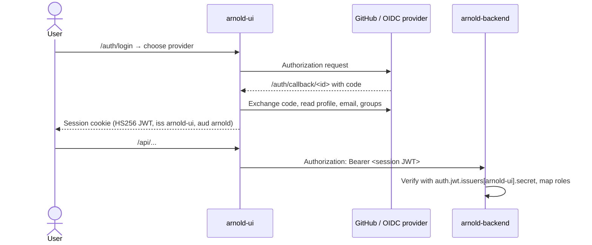

# Sign-in

Sign-in is handled by the UI server. It supports GitHub, Google and any OpenID Connect provider (Keycloak, Okta,
Auth0, Azure AD/Entra ID, GitLab, …), several at once. After sign-in the UI issues a session JWT and forwards it to
the backend, which trusts it through a shared secret.



## Development mode

The quick start uses `auth.mode: dev`: no sign-in, and the backend treats every request as user `dev` with the
`superadmin` role. It needs both:

- UI: `auth.mode: dev` and `ARNOLD_ALLOW_DEV_AUTH=true` (the UI refuses to start in dev mode otherwise);
- backend: `ARNOLD_DEV_AUTH=true`.

Never use development mode on a reachable host.

## 1. Register OAuth clients

| Provider | Where | Callback URL |
|---|---|---|
| GitHub | Settings → Developer settings → **OAuth Apps** (not the GitHub App) | `<publicUrl>/auth/callback/github` |
| Google | Cloud Console → APIs & Services → Credentials → OAuth client ID (Web application) | `<publicUrl>/auth/callback/google` |
| Any OIDC | Your identity provider | `<publicUrl>/auth/callback/<id>` |

`<id>` is the provider `id` in the UI configuration below.

## 2. UI configuration

For Docker Compose, edit `deploy/ui/development.yaml`. Elsewhere, provide `config/production.yaml` (see
`arnold-ui/config/production.example.yaml`).

```yaml
application:
  devMode: false
server:
  host: 0.0.0.0
  port: 3000
api:
  host: http://server:8090
  domain: server
  port: 8090
auth:
  mode: oauth
  publicUrl: http://localhost:3000          # externally reachable UI URL
  sessionSecret: <openssl rand -hex 32>     # >= 32 bytes; shared with the backend
  sessionTtlSeconds: 43200                  # 12 h
  allowedEmailDomains: [example.com]        # optional
  providers:
    - id: github
      type: github
      label: GitHub
      clientId: ...
      clientSecret: ...
      allowedOrganizations: [acme]          # optional: org members only
    - id: google
      type: oidc
      label: Google
      issuer: https://accounts.google.com
      clientId: ...
      clientSecret: ...
    - id: sso
      type: oidc
      label: Company SSO
      issuer: https://sso.example.com/realms/engineering
      clientId: ...
      clientSecret: ...
      groupsClaim: groups                   # claim holding group names, for role mappings
```

### Provider options

| Key | Types | Default | Meaning |
|---|---|---|---|
| `id` | all | | URL-safe id; part of the callback URL |
| `type` | all | | `github` or `oidc` |
| `label` | all | | Button label on the login page |
| `clientId`, `clientSecret` | all | | OAuth client credentials |
| `issuer` | `oidc` | | Issuer URL; endpoints are discovered from `/.well-known/openid-configuration` |
| `scopes` | all | `openid email profile` (oidc), `read:user user:email read:org` (github) | Requested scopes |
| `groupsClaim` | `oidc` | `groups` | Claim that lists the user's groups |
| `allowedOrganizations` | `github` | `[]` | Allow only members of these organizations. Org names become the user's groups |

### Auth options

| Key | Env override | Default | Meaning |
|---|---|---|---|
| `auth.mode` | `ARNOLD_AUTH_MODE` | `oauth` | `oauth` or `dev` |
| `auth.publicUrl` | `ARNOLD_UI_URL` | `http://localhost:3000` | External UI URL. Cookies are `Secure` when it is `https://` |
| `auth.sessionSecret` | `ARNOLD_UI_JWT_SECRET` | | HS256 secret, at least 32 bytes |
| `auth.sessionTtlSeconds` | | `43200` | Session lifetime |
| `auth.allowedEmailDomains` | | `[]` | Restrict sign-in to these email domains |
| `auth.secureCookies` | | from `publicUrl` | Force the cookie `Secure` flag |

## 3. Backend configuration

```bash title=".env"
ARNOLD_UI_JWT_SECRET=<same value as auth.sessionSecret>
ARNOLD_DEV_AUTH=false
```

In `docker-compose.yml`, set `ARNOLD_DEV_AUTH: "false"` on `server` (the compose file pins it to `"true"`) and remove
`ARNOLD_ALLOW_DEV_AUTH` from `ui`.

## 4. Admins and roles

Grant `superadmin` by email or user id with `ARNOLD_ADMINS=alice@example.com,bob@example.com`, or in the config
file, where you can also map identity-provider groups to roles:

```yaml title="local.yml"
serviceCoreConfiguration:
  auth:
    admins: [alice@example.com]
    roleMappings:
      arnold-admins: [superadmin]       # OIDC group or GitHub org → roles
```

See [Roles and API keys](../configuration/auth.md) for all roles.

## 5. Restart

```bash
docker compose up -d --force-recreate server ui
```

`/auth/login` now shows a button per provider. `/auth/logout` signs out.

## Trusting another token issuer

The backend can also accept JWTs from other issuers, for example to call the API from scripts with tokens from your
IdP. Add a JWKS-backed issuer:

```yaml title="local.yml"
serviceCoreConfiguration:
  auth:
    jwt:
      issuers:
        - { issuer: arnold-ui, audience: arnold, secret: "${ARNOLD_UI_JWT_SECRET}" }
        - { issuer: https://sso.example.com/realms/engineering, audience: arnold, jwksUrl: https://sso.example.com/realms/engineering/protocol/openid-connect/certs }
```
